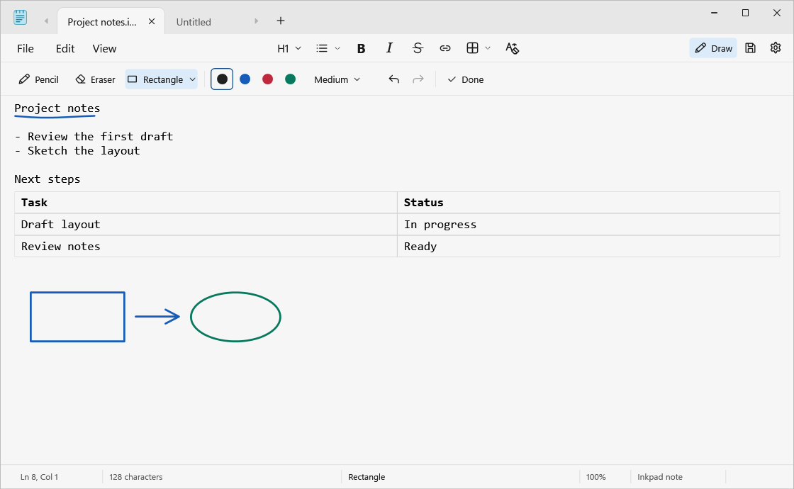

# Inkpad

Inkpad is a portable Windows editor for text, checklists, tables, and freehand drawing. It works offline and saves notes to files you choose. It has no account, subscription, installer, or background service.



## Run Inkpad on Windows

1. Open [GitHub Releases](../../releases/latest) and download `Inkpad.exe` from the release assets. If a release asset is unavailable, follow the build instructions below.
2. Keep the executable in Downloads or another folder you can find later. Double-click it to start Inkpad. No installation step is required.
3. For desktop access, right-click `Inkpad.exe` in File Explorer and choose **Show more options → Send to → Desktop (create shortcut)**. If you move the executable, recreate the shortcut from the new location.

Inkpad uses the Windows .NET Framework 4.8 desktop runtime. Windows 11 includes a compatible runtime. An older Windows installation may need [Microsoft .NET Framework 4.8](https://dotnet.microsoft.com/en-us/download/dotnet-framework/net48).

### Open files from Explorer

In Inkpad, open the gear menu and turn on **Show Edit in Inkpad in File Explorer**. Right-click a supported file, choose **Show more options** if needed, and select **Edit in Inkpad**. You can switch the entry off in the same menu. If you move Inkpad, turn the entry on again from its new location. This setting is per Windows user and keeps your current default app for text files.

## Use Inkpad

- **Tabs and files.** Press **Ctrl+N** for a new tab, **Ctrl+O** to open files, **Ctrl+Tab** to switch tabs, and **Ctrl+W** to close the current tab. A dot at the end of a tab marks unsaved changes. The dot clears after you save. Hover over the dot to reveal the close button. Inkpad remembers its window position, size, and maximized state.
- **Text and formatting.** Use the toolbar for heading styles, bulleted and numbered lists, bold, italic, and strikethrough. Press **Ctrl+F** to find text. Use **Ctrl+K** to add a web link and **Ctrl+click** to open a link.
- **Inline checkboxes.** Put the caret where you want the box and click the checkbox icon or press **Ctrl+Shift+Space**. Click the box to toggle it. You can also put the caret next to a box and press **Ctrl+Space**.
- **Checkbox colors.** Open the color swatch next to the checkbox icon. Pick a preset or choose **More colors…** for a custom RGB color. The color applies to the outline and check mark. Select existing boxes or place the caret directly next to one to recolor it. Pressing Enter in a colored checklist carries that item's color to the next box.
- **Checklists.** Choose **Checklist** from the list menu or press **Ctrl+Shift+L**. Press **Enter** on a line with an item to create the next unchecked box. Press **Enter** on an empty item to end the list. Indentation is carried to the next item.
- **Tables.** Open the table grid and pick the number of rows and columns. Press **Tab** or **Shift+Tab** to move between cells. Right-click a cell or reopen the toolbar’s table menu to insert or remove rows and columns.
- **Highlighting and images.** Select text or put the cursor on a line, then choose a color from the highlight menu. Paste an image with **Ctrl+V** or insert one from a file. Click the image, then drag a handle on its border to resize it. Choose **Crop**, drag the handles inward to keep the part you want, and click **Apply crop**. Drag the image to move it to another paragraph, or use **Wrap** to set its placement. Save as `.inknote` to keep images and highlights.
- **Settings and editing.** Use the gear to change theme, editor font, wrapping, startup tabs, spelling, and other preferences. **Ctrl+H** replaces text, **Ctrl+G** goes to a line, and **F5** inserts the date and time. The Writing tools menu uses local templates and text transformations.
- **Drawing.** Click **Draw** or press **Ctrl+D**. Open the arrow beside **Pencil** or **Highlighter** for colors, a live stroke preview, and thickness. The highlighter draws translucent strokes anywhere on the page. Turn on **Text only highlight** and drag across words to highlight just the text. Use **Shapes** for lines, arrows, rectangles, ellipses, and triangles. Hold **Shift** to snap the angle or constrain the shape. Use **Eraser** to remove an ink stroke, and press **Esc** or click **Done** to return to typing.

### Save and reopen notes

- **Ctrl+S** saves the current tab. **Ctrl+Shift+S** opens Save As.
- Use `.txt` for plain text and checkboxes. Checkboxes are stored as `☐` and `☑`, so the checked state is visible in other text editors.
- Use `.inknote` to keep checkbox colors, formatting, tables, hyperlinks, and drawings together. When you add those features to an existing text file, Inkpad prompts you to save the complete note as `.inknote`.
- Use **File → Export text only** to write a plain-text copy of a formatted note. The export keeps the text and checkbox characters.
- If Windows blocks a save, use **Save as…** in the error prompt and choose a writable folder. The edited note stays open so you can save a copy.

## Build from source

Install Git and the [.NET Framework 4.8 Developer Pack](https://dotnet.microsoft.com/en-us/download/dotnet-framework/net48) on a 64-bit Windows machine. Open PowerShell and run:

```powershell
git clone https://github.com/abdulmanan093/Inkpad.git
Set-Location Inkpad
powershell.exe -NoProfile -ExecutionPolicy Bypass -File .\src\build.ps1
```

The build creates `src\Inkpad.exe`. It uses the Windows .NET Framework C# compiler and WPF reference assemblies. There are no NuGet packages to restore. To run the integration checks:

```powershell
powershell.exe -NoProfile -ExecutionPolicy Bypass -File .\src\build.ps1 -Test
.\src\InkpadTests.exe .\src\qa
```

To remove Inkpad, turn off its Explorer entry if enabled, then delete the executable and Desktop shortcut. Your notes stay wherever you saved them. Window placement is stored in `%LOCALAPPDATA%\Inkpad\window.txt`.
