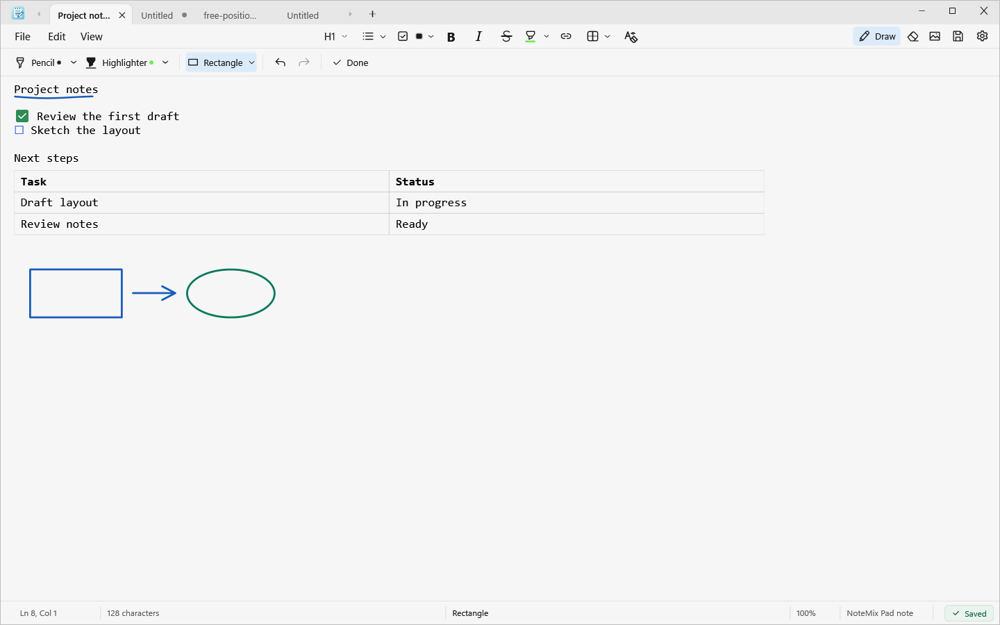

# NoteMix Pad

NoteMix Pad is a free Windows editor for notes, checklists, tables, drawing, and images. It works offline and saves notes to files you choose. The portable build runs without an account, subscription, or installer.



## Run NoteMix Pad on Windows

1. Open [GitHub Releases](../../releases/latest) and download **NoteMixPad.exe** from Assets.
2. Move the executable to a folder where you want to keep it, then double-click it to open NoteMix Pad.
3. For desktop access, right-click the executable and choose **Show more options → Send to → Desktop (create shortcut)**. Name the shortcut **NoteMix Pad**. For Start search, copy the shortcut into the folder opened by `shell:programs` in the Windows **Run** dialog.

NoteMix Pad uses the Windows .NET Framework 4.8 desktop runtime. Windows 11 includes a compatible runtime. An older Windows installation may need [Microsoft .NET Framework 4.8](https://dotnet.microsoft.com/en-us/download/dotnet-framework/net48).

### Open files from Explorer

In the portable app, open **Settings** and turn on **Edit in File Explorer**. Right-click a supported file, choose **Show more options** if needed, and select **Edit in NoteMix Pad**. Turn the setting on again after moving the executable. This setting applies to your Windows account.

## Use NoteMix Pad

- **Tabs and files.** Press **Ctrl+N** for a new tab, **Ctrl+O** to open files, **Ctrl+Tab** to switch tabs, and **Ctrl+W** to close the current tab. A dot at the end of a tab marks unsaved changes. The dot clears after you save. Hover over the dot to reveal the close button. Inkpad remembers its window position, size, and maximized state.
- **Text and formatting.** Use the toolbar for heading styles, bulleted and numbered lists, bold, italic, and strikethrough. Press **Ctrl+F** to find text. Use **Ctrl+K** to add a web link and **Ctrl+click** to open a link.
- **Inline checkboxes.** Put the caret where you want the box and click the checkbox icon or press **Ctrl+Shift+Space**. Click the box to toggle it. You can also put the caret next to a box and press **Ctrl+Space**.
- **Checkbox colors.** Open the color swatch next to the checkbox icon. Pick a preset or choose **More colors…** for a custom RGB color. The color applies to the outline and check mark. Select existing boxes or place the caret directly next to one to recolor it. Pressing Enter in a colored checklist carries that item's color to the next box.
- **Checklists.** Choose **Checklist** from the list menu or press **Ctrl+Shift+L**. Press **Enter** on a line with an item to create the next unchecked box. Press **Enter** on an empty item to end the list. Indentation is carried to the next item.
- **Tables.** Open the table grid and pick the number of rows and columns. Press **Tab** or **Shift+Tab** to move between cells. Right-click a cell or reopen the toolbar’s table menu to insert or remove rows and columns.
- **Highlighting and images.** Click the highlighter to toggle highlighting for the selected text or for typing. Use the arrow to choose a color. Click the image icon to open a file, or paste an image with **Ctrl+V**. Drag the image over the page, including over text and page ink. Click it to show resize handles. Drag a corner to adjust width and height independently, drag a side to adjust one dimension, or use **Crop** to trim the image. Strokes that start on an image stay with that image when it moves. Save as `.notemix` to keep images and highlights.
- **Undo and redo.** Use **Ctrl+Z** and **Ctrl+Y** to step through text, formatting, images, and drawing changes in the order you made them.
- **Settings and editing.** Use the gear to change theme, editor font, wrapping, startup tabs, spelling, and other preferences. **Ctrl+H** replaces text, **Ctrl+G** goes to a line, and **F5** inserts the date and time.
- **Drawing.** Click **Draw** or press **Ctrl+D**. Open the arrow beside **Pencil** or **Highlighter** for colors, a live stroke preview, and thickness. The highlighter draws translucent strokes anywhere on the page. Turn on **Text only highlight** and drag across words to highlight just the text. Use **Shapes** for lines, arrows, rectangles, ellipses, and triangles. Hold **Shift** to snap the angle or constrain the shape. Click **Eraser** on the main toolbar to remove ink strokes. Press **Esc** or click **Done** to return to typing.

### Save and reopen notes

- **Ctrl+S** saves the current tab. **Ctrl+Shift+S** opens Save As.
- Use `.txt` for plain text and checkboxes. Checkboxes are stored as `☐` and `☑`, so the checked state is visible in other text editors.
- Use `.notemix` to keep checkbox colors, formatting, tables, hyperlinks, and drawings together. When you add those features to an existing text file, NoteMix Pad prompts you to save the complete note as `.notemix`.
- Existing `.inknote` files still open and save in place. Use **File → Save As** to create a `.notemix` copy.
- Use **File → Export text only** to write a plain-text copy of a formatted note. The export keeps the text and checkbox characters.
- If Windows blocks a save, use **Save as…** in the error prompt and choose a writable folder. The edited note stays open so you can save a copy.

## Build from source

Install Git and the [.NET Framework 4.8 Developer Pack](https://dotnet.microsoft.com/en-us/download/dotnet-framework/net48) on a 64-bit Windows machine. Open PowerShell and run:

```powershell
git clone https://github.com/abdulmanan093/Inkpad.git
Set-Location Inkpad
powershell.exe -NoProfile -ExecutionPolicy Bypass -File .\src\build.ps1
```

The build creates `src\NoteMix Pad.exe` using the Windows .NET Framework C# compiler and WPF reference assemblies. To run the integration checks, use these commands.

```powershell
powershell.exe -NoProfile -ExecutionPolicy Bypass -File .\src\build.ps1 -Test
.\src\InkpadTests.exe .\src\qa
```

To remove the portable app, turn off **Edit in File Explorer** if enabled, then remove the executable and its shortcuts. Notes are stored in the folders you selected. Window placement and preferences are under `%LOCALAPPDATA%\Inkpad`.

## Microsoft Store package

See the [Store submission guide](store/Submission.md) for the Windows SDK build command and the files to upload to Partner Center.
